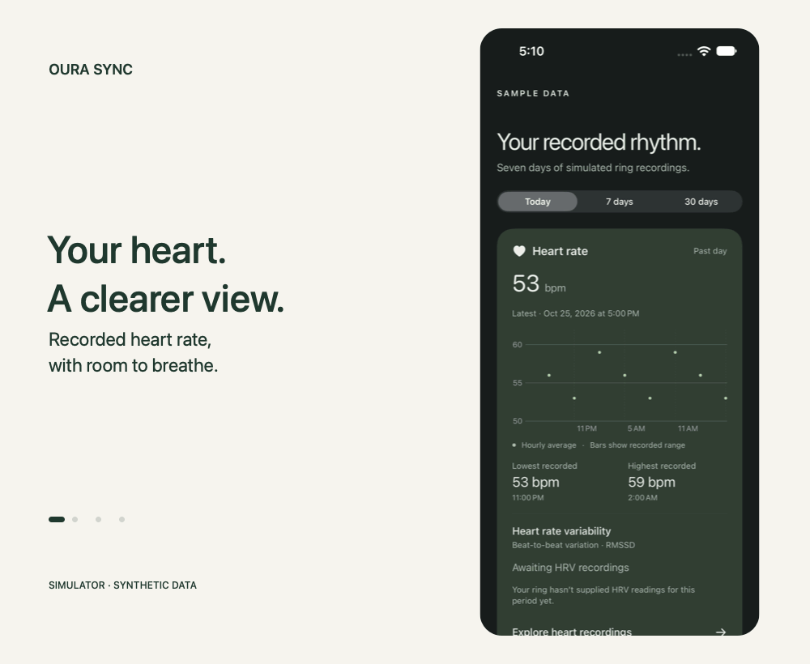
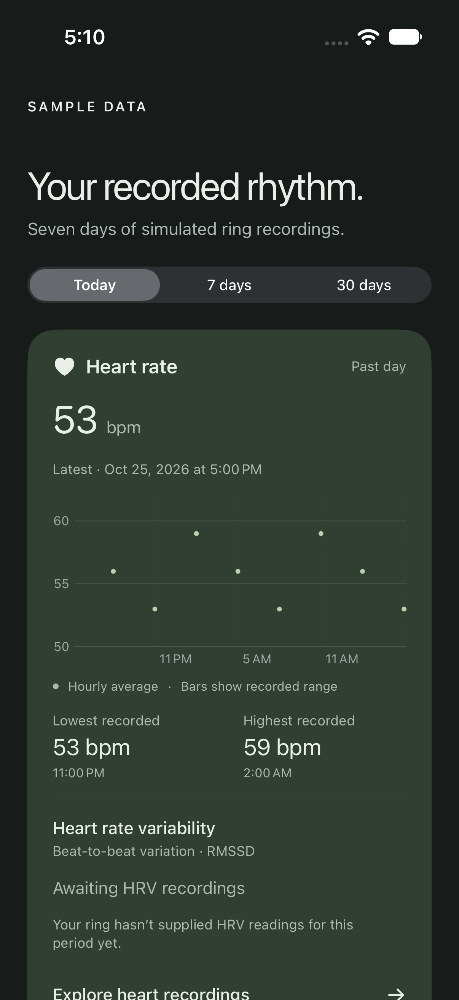
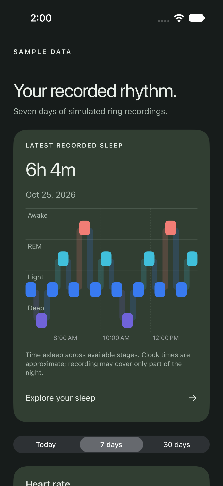
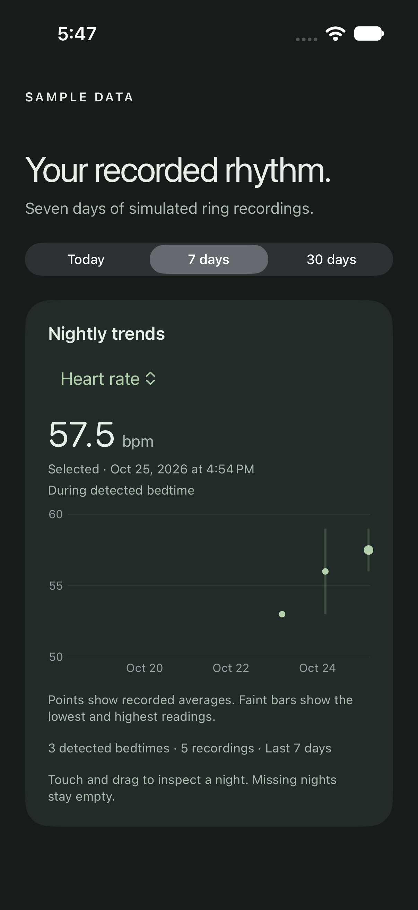
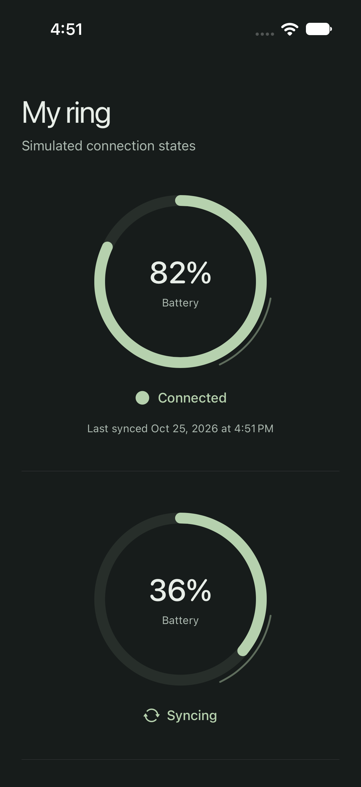

# Oura Sync

> [!WARNING]
> This project is almost entirely vibecoded as an experiment to see if I could replace the unnecessary and frustrating Oura membership with a proper offline iOS app. Use at your own risks.

A native SwiftUI app for syncing an Oura Horizon Gen 3 directly over Bluetooth. No Oura account is required for pairing or syncing.

Simulator screenshots and walkthrough use synthetic recordings, not personal health data.

  
  
  
  

## What works

- Factory-reset onboarding without existing ring keys.
- Bluetooth history sync, background reconnection, and pull to refresh.
- Apple Health export for supported measurements.
- Heart-rate charts, sleep-stage timelines, nightly trends, and low-battery notifications.

## Current limits

This is an independent implementation, not a replacement for every Oura feature.

- **Steps, calories, and automatic workouts:** not implemented. Activity intensity and movement recordings are available, but are not step counts. `open_health` estimates displayed steps from fixed cadences at MET thresholds; we do not use that heuristic. Its model-based workout pipeline is separate and requires proprietary weights omitted from the repository.
- **Advanced scores and predictions:** readiness, stress, resilience, cardiovascular age, fitness, and reproductive predictions are not implemented.
- **Oxygen calibration:** raw recordings are retained, including values above 100. The current in-app charts use only values in 1–100 and carry an unvalidated-calibration warning; that filtering does not establish accuracy. Apple Health exports are disabled, including when permission was previously granted. We do not apply guessed offsets, clamps, or calibration formulas for other hardware. A personal baseline will not resolve an unknown sensor conversion. Re-enabling export requires a supported Gen 3 processing method and matching overnight reference recordings. Previously exported samples are not automatically deleted or corrected.
- **Overnight measurements:** HRV, skin temperature, breathing, oxygen, and sleep records have been received from a Horizon Gen 3 after a night of wear. This confirms data availability, not sensor accuracy. Sleep-stage clock times are estimated, so stages are not exported to Apple Health. Charts preserve short stage changes rather than smoothing them away.
- **Background sync:** iOS controls execution. Leave the app in the app switcher; force-quitting can prevent syncing. Controlled background transfers and a short locked-phone sync with Health export have passed; autonomous overnight reliability remains unverified. **My ring → Sync details** shows the latest actual foreground and background transfers. Foreground downloads continue until caught up; background downloads save progress within a limited execution window.

Apple Health currently receives permitted heart-rate, respiratory-rate, RMSSD HRV (iOS 27+), and **in-bed** records. In-bed time is not time asleep. Finger skin temperature is not exported as body or Apple Watch wrist temperature. We do not export sleep stages, derived resting heart rate, steps, calories, or workouts. Raw history stays on the phone so decoding can improve without losing the original recordings.

## Run

Open `OuraSync.xcodeproj` in Xcode, select your own signing team, and run the `OuraSync` scheme on an iPhone with Developer Mode enabled. The deployment target is iOS 17; Health export of RMSSD requires iOS 27. Development has been tested with Xcode 27.1.

Follow **My ring → Set up my ring** for reset and pairing instructions. Bluetooth is required; Health and notification permissions are optional.

Run protocol tests with `swift test`. App and UI tests run through the Xcode scheme. Simulator media does not demonstrate a live Bluetooth connection.

## Research

Built from [open_oura](https://github.com/Th0rgal/open_oura) and [open_health](https://github.com/Th0rgal/open_health). Upstream attribution is preserved in [THIRD_PARTY_LICENSES](THIRD_PARTY_LICENSES). Not affiliated with Oura.
